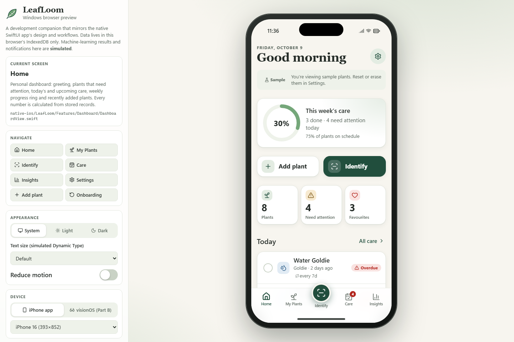
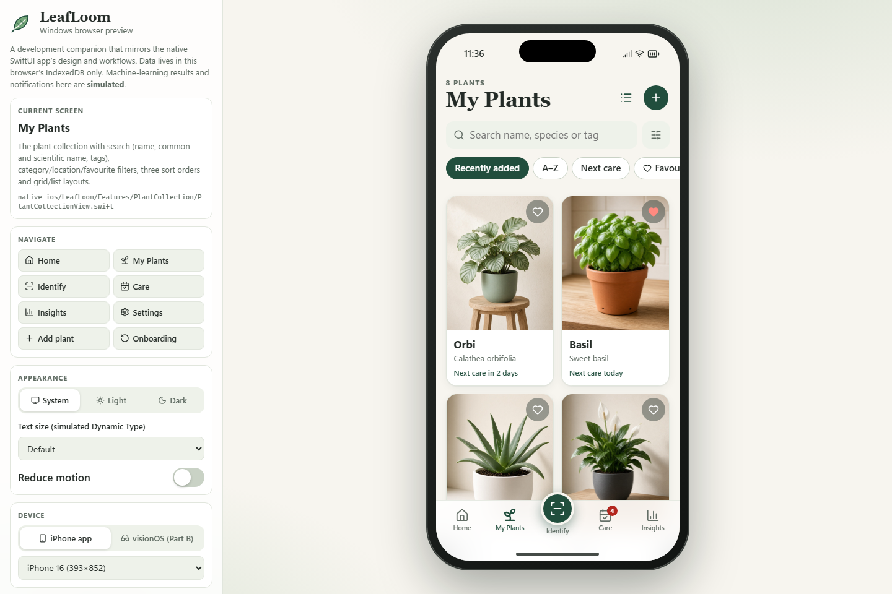
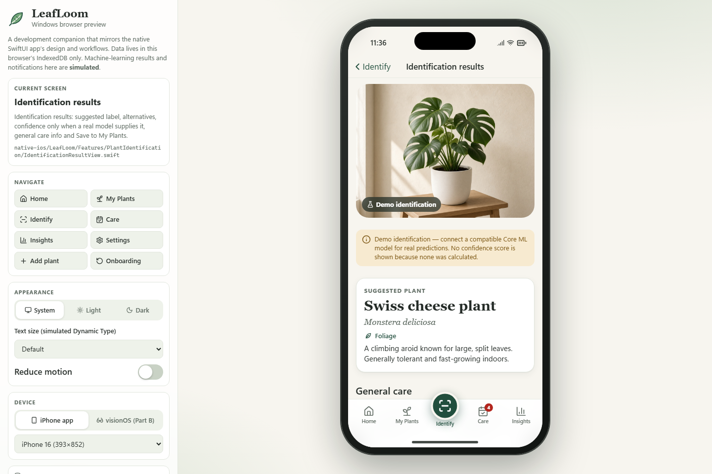
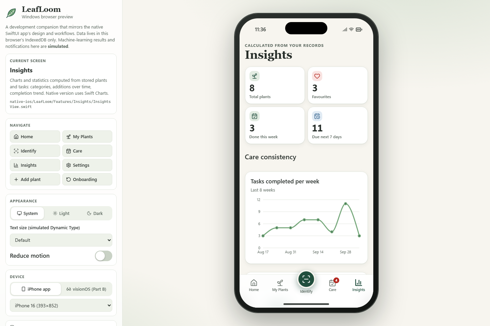
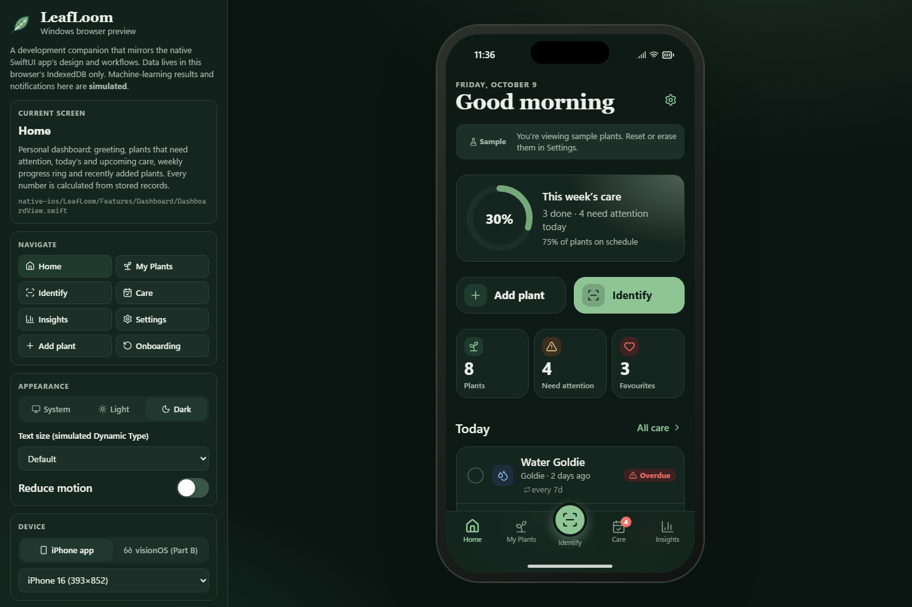

# LeafLoom — AI Plant Care & Smart Gardening

_Grow with confidence._

LeafLoom is a calm, private iPhone app for houseplant owners. You can:
- keep a collection of your plants, with photos and care needs,
- schedule repeating care with reminders,
- record growth in a journal with before/after photos,
- see your progress in charts,
- get on-device plant identification suggestions with Core ML.

Everything stays on the device. There is no account and no server.

SE4041 Mobile Application Design and Development — Assignment 02.

| Home | My Plants | Identify (simulated) | Insights | Dark Mode |
|---|---|---|---|---|
|  |  |  |  |  |

_These screenshots are from the Windows browser preview, which mirrors the native screens. Native
simulator screenshots are to be added after building on a Mac._

## What's in this folder

| Folder | What it is | Status |
|---|---|---|
| [`native-ios/`](native-ios/) | **The app.** SwiftUI for iOS 17: Core Data, Core ML + Vision (with a labelled demo mode), PhotosUI, UserNotifications, Swift Charts, XCTest. | Source complete. **Not yet compiled — needs a Mac with Xcode 16+.** |
| [`windows-preview/`](windows-preview/) | Interactive browser preview (React + TypeScript + Vite) used to design and test on Windows. Same screens and rules; data in IndexedDB. | **Verified on Windows**: lint, 58/58 unit tests, build, 5/5 end-to-end flows |
| [`partB-visionos/`](partB-visionos/) | **Part B — LeafLoom Spatial**, a visionOS 2 prototype: arrange plants life-size in your room and see which spots suit them. Includes the concept, competitor review and pitch. | Source and docs complete. **Not yet compiled.** |
| [`docs/`](docs/) | Requirements, architecture, design system, guides, test plan, report, AI log | Complete |
| [`scripts/`](scripts/) | `verify-native.sh` (Mac build and tests), `generate-native-assets.mjs` (asset catalog from shared assets) | — |

## Quick start

### Windows (or any machine with Node.js 20+): browser preview

```bash
cd windows-preview
npm install
npm run dev          # open the printed URL (http://localhost:5173)
```

| Command | Purpose |
|---|---|
| `npm run lint` | ESLint |
| `npm test` | Vitest unit and component tests |
| `npm run build` | Type-check and production build |
| `npx playwright install chromium` then `npm run e2e` | End-to-end flows and screenshots |

The dev panel beside the phone frame lets you:
- switch device size, theme, text size and reduce motion,
- jump between screens,
- reset or erase data,
- open the **Spatial (Part B)** simulation.

Identification and reminders are **simulated** in the preview and labelled as such.

### Mac: native app and visionOS prototype

Follow [`docs/WINDOWS_TO_MAC_GUIDE.md`](docs/WINDOWS_TO_MAC_GUIDE.md) to copy the folder, by OneDrive, zip or USB (no git needed). Then:

```bash
chmod +x scripts/verify-native.sh
./scripts/verify-native.sh        # builds and tests iOS, then visionOS
```

Or open `native-ios/LeafLoom.xcodeproj` (or `partB-visionos/LeafLoomSpatial.xcodeproj`) in Xcode and press ⌘R.

## Features

- **Collection:**
  - search, filters (category, location, favourites), three sorts, grid or list layout,
  - photos from the library or camera,
  - validation with helpful messages.
- **Care:**
  - watering, fertilising and other tasks,
  - repeating schedules counted from the day you actually did the task,
  - undo, swipe actions, overdue grouping,
  - local reminders at your chosen hour.
- **Identify:**
  - Core ML + Vision on device.
  - Without a model, a clearly labelled demo mode that never shows a confidence score.
  - Low-confidence warning below 40%.
  - Results prefill the add-plant form for review.
  - See [`docs/CORE_ML_GUIDE.md`](docs/CORE_ML_GUIDE.md) to train and add a model with Create ML.
- **Growth journal:** notes, photos and height; a before/after slider; a growth summary.
- **Insights:** weekly completion trend, care mix, plants by category, monthly additions. Every chart has a spoken summary.
- **Settings:** theme, layout, reminders, replay onboarding, reset to sample data, erase all data, about.
- **Accessibility:** VoiceOver labels, Dynamic Type, Dark Mode and Reduce Motion. Status uses text and an icon, never colour alone.

## Documentation

| Document | Contents |
|---|---|
| [**LeafLoom_Documentation.pdf**](docs/LeafLoom_Documentation.pdf) | Full illustrated documentation (25 pages): every feature with screenshots, design, architecture, Part B, testing. Rebuild: `npm run docs-shots && npm run docs-pdf` in `windows-preview/` |
| [PRODUCT_REQUIREMENTS](docs/PRODUCT_REQUIREMENTS.md) | Users, features, acceptance criteria |
| [ARCHITECTURE](docs/ARCHITECTURE.md) | Layers, navigation, Core Data model, ML service, scheduling, Part B |
| [UI_DESIGN_SYSTEM](docs/UI_DESIGN_SYSTEM.md) | Colours, type, spacing, components, accessibility |
| [CORE_ML_GUIDE](docs/CORE_ML_GUIDE.md) | Create ML training, conversion, installing a model |
| [TEST_PLAN](docs/TEST_PLAN.md) | Strategy, **real** preview results, native tests awaiting a Mac, UAT script |
| [USER_GUIDE](docs/USER_GUIDE.md) | How to use the app |
| [WINDOWS_TO_MAC_GUIDE](docs/WINDOWS_TO_MAC_GUIDE.md) | Moving to a Mac, building, recording results |
| [DEVELOPMENT_REPORT](docs/DEVELOPMENT_REPORT.md) | Decisions, challenges, limitations, future work |
| [AI_USAGE_LOG](docs/AI_USAGE_LOG.md) | AI assistance used and how it was checked |
| [ASSET_ATTRIBUTION](docs/ASSET_ATTRIBUTION.md) | Origin of every image and icon |
| [CHECKLIST](docs/CHECKLIST.md) | Requirement-by-requirement status |
| Part B: [CONCEPT](partB-visionos/docs/CONCEPT.md), [COMPETITORS](partB-visionos/docs/COMPETITORS.md), [PITCH](partB-visionos/docs/PITCH.md) | visionOS prototype |

## Honesty notes

- The Swift code (iOS and visionOS) was written on Windows and **has not been compiled or run**. Expect some fixes on the first Xcode build. Record them in the AI usage log.
- **No Core ML model is included** and no accuracy is claimed. Identification runs in demo mode until you train one.
- Sample plant photos are AI-generated and illustrations are original; see `ASSET_ATTRIBUTION.md`.
- Market figures in the pitch are deliberately left to be sourced, and competitor details should be checked against current App Store listings.
- This project does not use git, at the developer's request.
