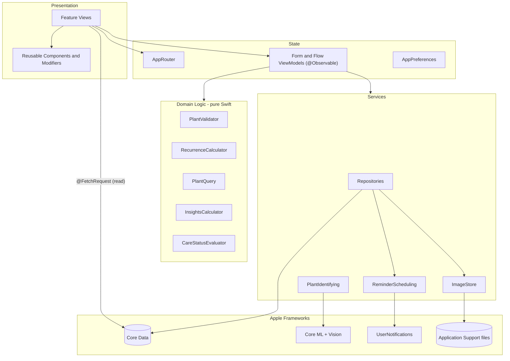
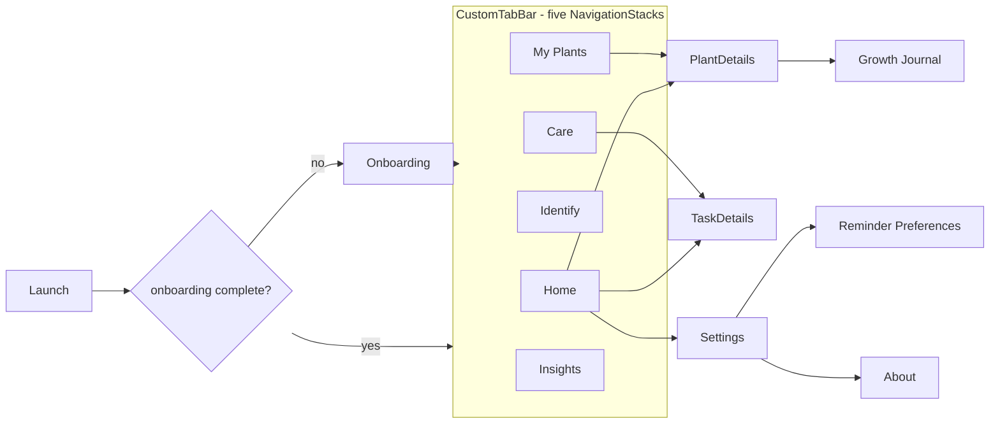
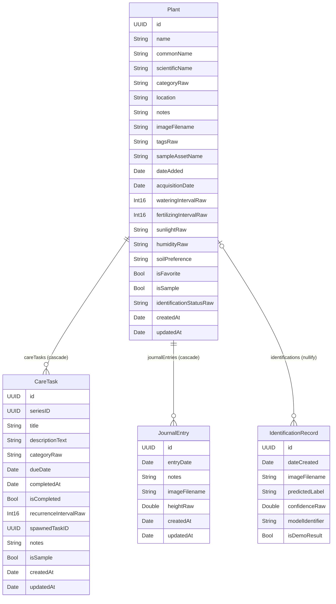
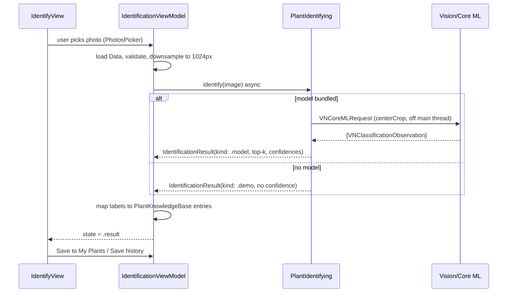
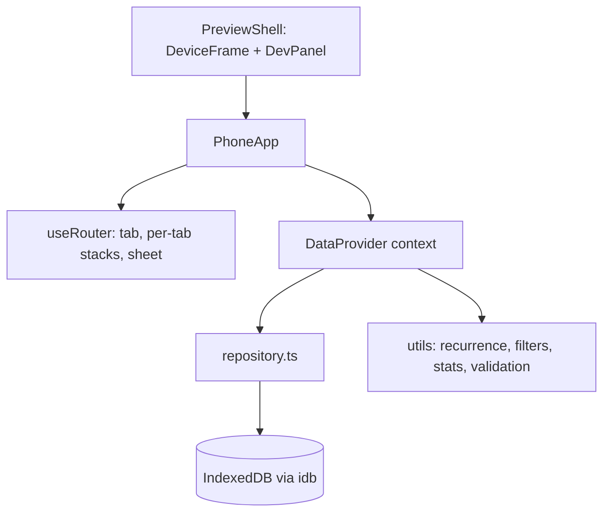
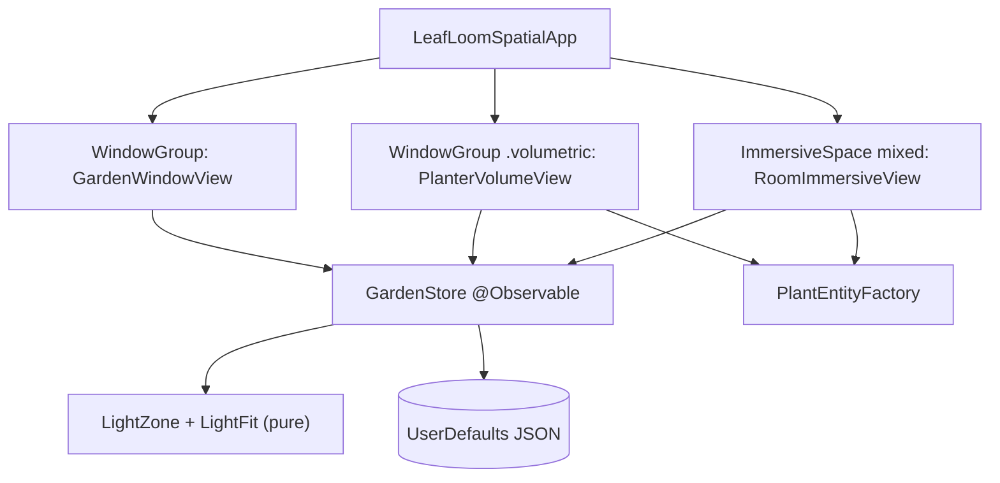

# LeafLoom — Architecture

This document describes the architecture of the **native SwiftUI application** (`native-ios/`), the **Windows browser preview** (`windows-preview/`) and the **Part B visionOS prototype** (`partB-visionos/`).

---

## 1. Platform and framework choices

| Concern | Choice | Minimum OS | Notes |
|---------|--------|-----------|-------|
| UI | SwiftUI | iOS 17 | `NavigationStack` (iOS 16+), `@Observable` (iOS 17+), `sensoryFeedback` (iOS 17+), `ContentUnavailableView` (iOS 17+) |
| Persistence | Core Data (`NSPersistentContainer`) | iOS 3+ | Model file `LeafLoom.xcdatamodeld`, manual `NSManagedObject` subclasses |
| Machine learning | Core ML via Vision (`VNCoreMLModel`, `VNCoreMLRequest`) | iOS 11+ | Model loaded dynamically by name; demo fallback |
| Photos | PhotosUI `PhotosPicker` | iOS 16+ | No library permission needed (out-of-process picker) |
| Camera | `UIImagePickerController` via `UIViewControllerRepresentable` (`CameraPicker` in `Core/Components/FormComponents.swift`) | — | Only UIKit interop in the app; shown only when a camera is available |
| Notifications | UserNotifications (`UNCalendarNotificationTrigger`) | iOS 10+ | Identifier = care-task UUID |
| Charts | Swift Charts (`BarMark`, `LineMark`, `SectorMark`) | iOS 16 / `SectorMark` iOS 17 | |
| Tests | XCTest | — | Unit tests against in-memory Core Data store |

**Deployment target: iOS 17.0.** This is the lowest version that supports every API above (notably `@Observable` and `SectorMark`) and is supported by Xcode 16.

---

## 2. Layered architecture

**Rules**

1. Views read Core Data reactively through `@FetchRequest` and never call `save()` directly. All mutations go through a repository.
2. Domain logic (validation, recurrence, filtering, statistics) is written as pure functions over small protocols (`PlantRepresentable`, `CareTaskRepresentable`) so it can be unit-tested without Core Data.
3. Services that touch Apple frameworks are protocol-backed (`PlantIdentifying`, `ReminderScheduling`) and injected via `AppEnvironment`, so tests can substitute fakes.

### Dependency container

`AppEnvironment` is created once in `LeafLoomApp` and placed into the SwiftUI environment. It owns:

- `PersistenceController`
- `PlantRepository`, `CareTaskRepository`, `JournalRepository`, `IdentificationRepository`
- `ImageStore`
- `PlantIdentifying` (Core ML if a model is bundled, otherwise demo)
- `ReminderScheduling`
- `AppPreferences`

Launch arguments (`-uiTesting`, `-resetData`, `-emptyState`, `-skipOnboarding`) switch to an in-memory store and deterministic data for UI tests.

---

## 3. Navigation

- `AppRouter` (`@Observable`) holds the selected tab, **one `NavigationPath` per tab**, and an optional `SheetRoute`.
- Push destinations are the `Route` enum: `.plantDetails(UUID)`, `.taskDetails(UUID)`, `.journal(UUID)`, `.settings`, `.reminderSettings`, `.about`.
- Modal forms are the `SheetRoute` enum: `.addPlant(prefill:)`, `.editPlant(UUID)`, `.addTask(plantID:)`, `.editTask(UUID)`, `.addJournal(plantID:)`, `.editJournal(UUID)`.
- `SheetHost` in `RootView.swift` resolves the record for edit routes (for example `env.plants.plant(id:)`) and passes it to the form's initialiser, so forms start with the saved values and never fetch inside `init`.
- Only one sheet can be active, and sheets never push onto the navigation stack, which prevents navigation loops. Saving from "Identify → Save to My Plants" dismisses the sheet, switches to the **My Plants** tab and pushes the new plant's details.
- Re-tapping the selected tab pops that tab to its root.

---

## 4. Core Data model

**Changes from the brief's suggested model (with reasons)**

| Change | Reason |
|--------|--------|
| `imageFilename` instead of binary image data | Keeps the SQLite store small; images are JPEG files in Application Support and downsampled on load. |
| `tags` as a comma-separated string | Tags are display/search only; a separate entity would add complexity without benefit. |
| `isSample` on Plant and CareTask | Lets "Reset sample data" remove only seeded records and lets the UI label demo content. |
| `seriesID` on CareTask | Links all occurrences of a recurring task so history can be shown and undo can find the spawned occurrence. |
| `spawnedTaskID` on CareTask | Records which occurrence a completion created, so undo removes exactly that one. |
| `sampleAssetName` on Plant | Sample plants show a bundled asset-catalog photo without copying it to disk. |
| `heightRaw` on JournalEntry | Allows a simple growth measurement; optional, never required. |
| Enum-backed and optional scalar attributes are stored as `…Raw` | The entity classes expose typed accessors (`category`, `sunlightPreference`, `tags`, `wateringIntervalDays: Int?`, `heightCm: Double?`, `confidence: Double?`), so the rest of the app never handles raw strings or sentinels. |
| Interval integers use `0` to mean "not set" | Core Data scalar optionals are awkward; the Swift accessors expose `Int?`. |
| `heightRaw` and `confidenceRaw` use `-1` to mean "not supplied" | Same reason; exposed as `Double?`. |

**Delete rules:** Plant → CareTask **Cascade**, Plant → JournalEntry **Cascade**, Plant → IdentificationRecord **Nullify** (identification history is kept as a historical record but loses its plant link). The repository also cancels notifications and deletes image files for removed records, so no orphans remain.

**Concurrency:** the `viewContext` is used for reads and small edits, all through `@MainActor` repositories. Seeding, "erase all" and "reset sample data" (`DataMaintenance` in `SampleDataSeeder.swift`) run on `newBackgroundContext()` inside `performAndWait`; the view context merges changes automatically (`automaticallyMergesChangesFromParent = true`, `NSMergeByPropertyObjectTrumpMergePolicy`).

**Migration strategy:** the store description sets `shouldMigrateStoreAutomatically` and `shouldInferMappingModelAutomatically` to `true`. Future model changes are made by adding a new model version (Editor → Add Model Version), setting it as current, and keeping changes lightweight-compatible (adding optional attributes, adding entities, renaming with a renaming identifier). Non-lightweight changes would require a mapping model or a staged migration (iOS 17 `NSStagedMigrationManager`).

---

## 5. Core ML identification service

- `PlantIdentifying` protocol: `var mode: IdentificationMode { get }` and `func identify(_ image: CGImage) async throws -> IdentificationResult`.
- `CoreMLPlantIdentificationService` looks for `LeafLoomPlantClassifier.mlmodelc` in the app bundle (Xcode compiles any `.mlmodel`/`.mlpackage` added to the target). It runs the Vision request on a detached task so the main actor is never blocked, and returns the top 5 observations.
- `DemoPlantIdentificationService` returns deterministic suggestions (a stable hash of image dimensions chooses from the knowledge base) and **never supplies a confidence value**. Every demo result is shown with a "Demo identification" banner.
- `LabelMapper` normalises model labels (`snake_plant`, `Snake Plant`, `dracaena_trifasciata`) to knowledge-base keys. Unknown labels are still shown, just without care information.
- Errors: `.modelUnavailable`, `.modelLoadFailed`, `.invalidImage`, `.noResults`, `.inferenceFailed` — each mapped to a friendly message.

See `CORE_ML_GUIDE.md` for training and installing a model.

---

## 6. Care scheduling and notifications

- **Recurrence rule:** when a task with `recurrenceIntervalDays = n` is completed at time `t`, it is stamped `isCompleted = true, completedAt = t`, and a new task in the same `seriesID` is created with `dueDate = startOfDay(t) + n days` at the original due time-of-day. Completing late therefore does not create a backlog of overdue occurrences.
- **Undo:** reverses the completion and deletes the occurrence recorded in `spawnedTaskID`, but only if it is still untouched (`createdAt == updatedAt`), so a user's edits are never thrown away.
- **Status:** `overdue` if not completed and `dueDate < startOfToday`; `dueToday`; `upcoming`; `completed`. Status is always shown with text and an icon, not colour alone.
- **Notifications:** `ReminderScheduler` schedules one `UNCalendarNotificationTrigger` per incomplete task at the user's preferred reminder hour on the due date (or 1 minute from now if that time has passed today). Identifier = task UUID string, so edits replace and deletion/completion cancels. If authorisation is denied, scheduling is skipped silently and Settings shows a banner with a link to system settings.

---

## 7. State management summary

| Tool | Used for |
|------|----------|
| `@State` | Local view state (search text, selected filter, sheet toggles, animation flags) |
| `@Binding` | Form fields in reusable components |
| `@Environment` | `AppEnvironment`, `AppRouter`, `managedObjectContext`, `accessibilityReduceMotion`, `dismiss` |
| `@Observable` | `AppRouter`, `AppPreferences`, `PlantFormViewModel`, `CareTaskFormViewModel`, `IdentificationViewModel`, `ToastCenter` |
| `@FetchRequest` | Lists of plants, tasks, journal entries |
| `@AppStorage` (inside `AppPreferences`) | Theme, layout, reminder hour, onboarding flag |

---

## 8. Browser preview architecture

- The preview mirrors the native data model in `src/types/models.ts` and the native domain logic in `src/utils/`.
- All mutations are written to IndexedDB **before** in-memory state is updated, so a reload always shows persisted data.
- The browser dataset is completely separate from the native Core Data store; there is no synchronisation.
- Identification in the preview is always simulated and labelled "Simulated".

---

## 9. Testing strategy

| Layer | Native | Preview |
|-------|--------|---------|
| Pure logic | XCTest: validator, recurrence, query/filter/sort, insights, care status, label mapping | Vitest: same rules |
| Persistence | XCTest with in-memory `PersistenceController` | Vitest with `fake-indexeddb` |
| Services | XCTest with `MockReminderScheduler` and the deterministic `DemoPlantIdentificationService` | — |
| UI | XCUITest with launch arguments for deterministic data | React Testing Library flows; Playwright end-to-end flows and screenshots |

See `TEST_PLAN.md` for cases and actual results.

---

## 10. Part B — LeafLoom Spatial (visionOS 2)

`partB-visionos/` is a separate Xcode project (`LeafLoomSpatial.xcodeproj`, synchronized folders, plus `project.yml`). It shares the iPhone app's sample plants and design language but not its code or store.

- `PlantEntityFactory` builds plants from RealityKit primitive meshes, seeded by plant UUID (`SeededGenerator`), with collision, input-target, hover and accessibility components.
- The immersive view uses targeted `DragGesture`, `RotateGesture3D(constrainedToAxis: .y)`, `MagnifyGesture` and `SpatialTapGesture`. Live updates use `persist: false`; `commitLayout()` saves once at gesture end.
- RealityView attachments show a billboarded tag above each plant; the selected one expands into a care card.
- See `partB-visionos/docs/CONCEPT.md` for details and limitations.
